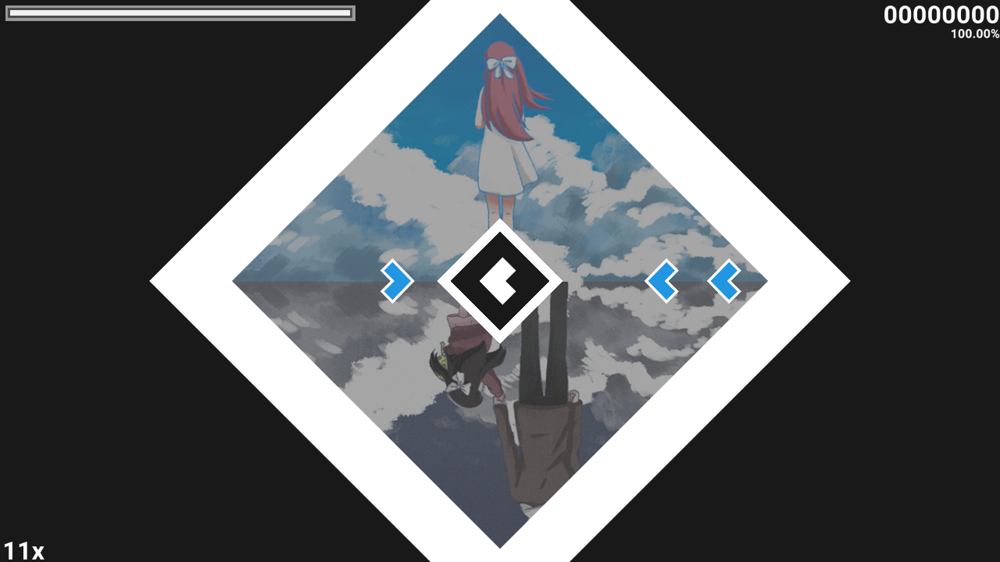

# Eity

Eity is a directional rhythm game. Turn to catch notes as they converge from four directions.

[Download prior releases](https://github.com/TheJeme/Eity/releases) · [itch.io artwork and page copy](promo/itch-page.md)



## Build

Install Python 3.9+ and Git. The Web target also uses Node.js and npm. From the repository root, choose one platform, several platforms, or all three.

```sh
python build.py web
python build.py windows linux
python build.py all
```

Use `python3` if that is how Python is installed. First builds download the pinned runtimes and cache them under `.build/`. The builds read the current working copies of tracked game files. Add new game files to Git before building.

| Target | Upload file | Local launch |
| --- | --- | --- |
| Windows x64 | `dist/Eity-windows.zip` | Extract the archive and run `Eity.exe`. |
| Linux x86-64 | `dist/Eity-linux.zip` | Extract the archive and run `./Eity`. The launcher extracts the bundled AppImage at runtime and works without FUSE. |
| Browser | `dist/Eity-web.zip` | Extract the archive, serve that directory with `python -m http.server 8000`, and open [localhost:8000](http://localhost:8000). |

For local development, run `love .` with [LÖVE 11.5](https://github.com/love2d/love/releases/tag/11.5).

## Upload to itch.io

Create an HTML project. Upload the Web ZIP intact and mark it as playable in the browser. A 16:9 embed such as 960 × 540 matches the game viewport. Enable mobile browser play for touch access. Upload the Windows and Linux ZIPs as downloads and select their platform flags. The browser build uses the non-threaded [love.js compatibility runtime](https://github.com/Davidobot/love.js#notes) for standard itch.io embeds. [itch.io HTML5 upload guide](https://itch.io/docs/creators/html5)

## Controls

| Input | During a song | Song selection |
| --- | --- | --- |
| Keyboard | Arrow keys or WASD to face a direction. Esc pauses and R restarts. | Arrow keys move through songs. Enter plays and Esc goes back. |
| Gamepad | D-pad, either stick, or the face buttons to face a direction. Start pauses. | From the title screen, press the top face button to open the song list. Move with the D-pad or a stick. Bottom face button plays, left face button picks a random song, and right face button goes back. |
| Touch | Use the four directional buttons and tap Pause in the upper-right. | Swipe the list to scroll. Tap a song to select it and tap Play to start. |

Mapped gamepads use SDL's standard layout. Controllers without a mapping use the first two axes, the hat, and the common raw button positions. Actual raw button positions depend on the controller.

Song Select plays a 12-second excerpt after the selection settles. Switching away during a song pauses playback. Resume with the existing pause controls. On Results, press R or Enter, the left face button, or tap Retry to replay with the same mods. The score difference compares your run with your previous best for that map.

## Modes and modifiers

Face incoming blue notes and stay lined up through holds. Enable Dodge on the Mods page to turn every arrival into a red tap. Face any of the other three directions to score. Catch and Dodge each keep their own grades and personal bests for the regenerated charts. Mirror swaps left and right throughout the song. On keyboard, M opens Mods. There, D toggles Dodge and R toggles Mirror.

## Charts

[Generate beat maps and see the Meteor Sightseeing track credits](tools/charting.md).

## License

[MIT](LICENSE)
